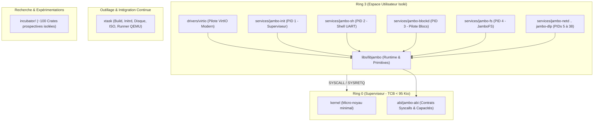
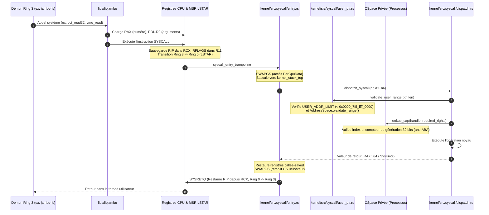

# Guide du Contributeur & Architecture Didactique de JamboOS

Bienvenue dans le guide de contribution et d'intégration de **JamboOS**.

Ce document est conçu pour les ingénieurs système, chercheurs en sécurité et développeurs Rust souhaitant comprendre l'anatomie pratique du micro-noyau et créer de nouveaux démons isolés en **Ring 3**.

---

## 1. Cartographie du Dépôt & Règle d'Isolation

Le monorepo JamboOS applique une stricte séparation entre le cœur de production (**Iron Core**) et l'incubateur de recherche (**Incubator**) :



---

## 2. Anatomie d'un Appel Système dans JamboOS

Dans JamboOS, aucun processus utilisateur ne détient d'autorité ambiante (*Zero Ambient Authority*). L'accès aux ressources matérielles ou logicielles nécessite un appel système explicite validant une capacité dans la `CSpace` privée du processus.

### 2.1 Diagramme de Séquence de Traversée Ring 3 $\to$ Ring 0 $\to$ Ring 3



### 2.2 Déconstruction des Registres x86_64

La convention d'appel système respecte strictement la **System V AMD64 ABI** :

| Registre | Rôle à l'Entrée (`SYSCALL`) | Rôle à la Sortie (`SYSRETQ`) |
| :--- | :--- | :--- |
| `RAX` | Numéro d'appel système (`SyscallNumber`) | Code de retour (`0` = Succès, `< 0` = `SysError`) |
| `RDI` | Argument 1 (`a1`) | Inchangé ou résultat optionnel |
| `RSI` | Argument 2 (`a2`) | Inchangé |
| `RDX` | Argument 3 (`a3`) | Seconde valeur de retour optionnelle (ex. offset) |
| `R10` | Argument 4 (`a4`) *(remplace `RCX` réservé par le CPU)* | Inchangé |
| `R8` | Argument 5 (`a5`) | Inchangé |
| `R9` | Argument 6 (`a6`) | Inchangé |
| `RCX` | Écrasé par le CPU avec l'adresse de retour `RIP` | Utilisé par `SYSRETQ` pour le retour Ring 3 |
| `R11` | Écrasé par le CPU avec les `RFLAGS` utilisateur | Restauré dans `RFLAGS` par `SYSRETQ` |

---

## 3. Tutoriel Pratique : Créer son Premier Démon Ring 3

Ce guide montre comment créer un microservice Ring 3 minimaliste, isolé et conforme, capable de communiquer avec le noyau et d'afficher un message via la console sécurisée.

### Étape 1 : Créer le manifeste `Cargo.toml` du service

Créez le fichier `services/jambo-hello/Cargo.toml` :

```toml
[package]
name = "jambo-hello"
version = "0.3.83"
edition = "2021"

[[bin]]
name = "jambo-hello"
path = "src/main.rs"
test = false
bench = false

[dependencies]
jambo-abi = { path = "../../abi/jambo-abi" }
libjambo = { path = "../../libs/libjambo" }
```

### Étape 2 : Écrire le point d'entrée `src/main.rs`

Tous les démons Ring 3 de JamboOS s'exécutent sans runtime C (`#![no_std]`, `#[no_main]`) :

```rust
#![no_std]
#![no_main]

use libjambo::println;

#[cfg(not(test))]
#[panic_handler]
fn panic(_info: &core::panic::PanicInfo) -> ! {
    loop {
        core::hint::spin_loop();
    }
}

#[no_mangle]
pub extern "C" fn _start() -> ! {
    println!("[HELLO] Bonjour depuis mon premier démon Ring 3 isolé sous JamboOS !");

    // Interrogation des métriques système via le Syscall 27 (SysInfo)
    let mut info = jambo_abi::SysInfoPayload::default();
    let ret = libjambo::syscall_sysinfo(&mut info);
    if ret == 0 {
        println!(
            "[HELLO] Métriques noyau : {} cœurs actifs, {} threads prêts",
            info.cpu_count, info.ready_threads
        );
    }

    // Boucle de service coopérative
    loop {
        libjambo::syscall_thread_yield();
    }
}
```

### Étape 3 : Compilation avec le Linker Script Utilisateur

Chaque binaire Ring 3 doit être linké avec le script [`libs/user-x86_64.ld`](file:///c:/Users/joker/Documents/jambo-os/libs/user-x86_64.ld) fixant son point d'entrée à `0x0040_0000` :

```bash
RUSTFLAGS="-C link-arg=-Tlibs/user-x86_64.ld -C relocation-model=static" \
    cargo build --package jambo-hello --target x86_64-unknown-none --release
```

### Étape 4 : Intégration dans l'Initrd via `xtask`

Pour que le superviseur `jambo-init` lance votre démon au démarrage :
1. Déclarez le membre dans le fichier racine [`Cargo.toml`](file:///c:/Users/joker/Documents/jambo-os/Cargo.toml).
2. Ajoutez le binaire dans la liste des services assemblés par `xtask/src/main.rs`.
3. Reconstruisez l'archive d'amorçage :
   ```bash
   cargo xtask build --release
   cargo xtask test --release
   ```

---

## 4. Règles d'Ingénierie & Critères de Qualité

Pour préserver la robustesse et la compacité de l'Iron Core, toute contribution doit respecter les critères suivants :

1. **Zéro Tas Non Maîtrisé** :
   Les démons Ring 3 s'exécutent par défaut sans tas dynamique global. Toutes les structures de files ou de messages doivent utiliser des buffers statiques ou bornés.
2. **Contrats `// SAFETY:` Obligatoires** :
   Chaque bloc `unsafe` dans le micro-noyau ou les bibliothèques d'accès matériel doit être obligatoirement précédé d'un commentaire explicitant :
   - Les préconditions requises.
   - L'absence de collision de pointeurs (*no aliasing*).
   - La garantie de non-violation mémoire.
3. **Respect de l'Autorité Ambiante Nulle** :
   Ne jamais introduire d'état global mutable partagé entre processus. Tout partage de données volumineuses passe exclusivement par un VMO explicite avec droits d'accès délégués via un canal IPC.
4. **Vérification Complète Avant Commit** :
   ```bash
   cargo fmt --all -- --check
   cargo clippy --package jambo-abi --package xtask -- -D warnings
   cargo check --workspace --target aarch64-unknown-none --exclude xtask
   cargo xtask build --release
   ```

