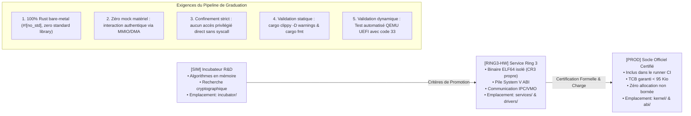

<p align="center">
  
</p>

<p align="center">
  
  &nbsp;&nbsp;&nbsp;&nbsp;&nbsp;&nbsp;&nbsp;&nbsp;&nbsp;&nbsp;&nbsp;&nbsp;
  
</p>

<h1 align="center"><strong>JamboOS (jambostack/jambo-os)</strong></h1>
<p align="center"><strong>Prototype Expérimental de Micro-noyau Orienté Capacités en Rust <code>#![no_std]</code></strong></p>

<p align="center">
  <a href="https://github.com/jambostack/jambo-os/actions/workflows/ci.yml"></a>
  <a href="https://github.com/jambostack/jambo-os"></a>
  <a href="LICENSE"></a>
  <a href="https://www.rust-lang.org/"></a>
</p>

<p align="center">
  <em>Auteur & Architecte Principal</em> : <strong>ASSOGBA Prudence Dieudonné</strong> &bull;
  <em>Dépôt officiel</em> : <a href="https://github.com/jambostack/jambo-os">https://github.com/jambostack/jambo-os</a><br>
  <em>Architectures cibles (expérimentales)</em> : x86_64 (Long Mode) & AArch64 (ARM64) / SMP / UEFI (Protocole Limine v3)
</p>

---

> [!WARNING]
> **Avertissement sur la Maturité & Stade du Projet : Version `v0.3.90` (Pre-Alpha / Prototype Expérimental)**  
> **JamboOS est un projet expérimental de recherche à un stade très initial (Pre-Alpha). Le système est encore très immature et à une année-lumière d'une version 1.0.0 utilisable en production.**  
> 
> Ce dépôt explore la faisabilité d'un micro-noyau moderne en Rust `![no_std]` inspiré des principes de seL4 et Zircon. Bien que le système démarre sous QEMU et sur machine UEFI réelle :
> * **Stade de Développement** : Les microservices et pilotes actuels sont des prototypes et squelettes fonctionnels minimaux servant de preuve de concept.
> * **Périmètre Opérationnel** : Pagination PML4 de base, ordonnanceur EEVDF expérimental, pilote VirtIO simplifié, arènes VMO, VFS POSIX (`fd_table`), et Dynamic Loader ELF64 Ring 3 (`libjambo::dynlink`).
> * **Feuille de Route** : De nombreux chantiers majeurs (pilotes matériels réels NVMe/USB, pile TCP/IP complète, système de fichiers persistant, audits formels et campagnes de fuzzing) devront être menés sur le long terme avant d'envisager une quelconque stabilité.
> 
> 📜 **Notes de Version v0.3.90** : Consultez [`docs/RELEASE_NOTES_v0.3.90.md`](docs/RELEASE_NOTES_v0.3.90.md).  
> 🚀 **Guide de Test Silicium** : Pour tester le prototype sur machine réelle, consultez [`docs/BAREMETAL.md`](docs/BAREMETAL.md).  
> 🎬 **Protocole de Démonstration** : Suivez le script de test pas-à-pas dans [`docs/DEMO.md`](docs/DEMO.md).  
> 📊 **Métriques Expérimentales** : Consultez les mesures préliminaires dans [`BENCHMARKS.md`](BENCHMARKS.md).  
> 🛠️ **Guide de Contribution** : Découvrez les conventions internes dans [`CONTRIBUTING.md`](CONTRIBUTING.md).  
> 🗺️ **Feuille de Route Détaillée** : Consultez notre planning dans [`ROADMAP.md`](ROADMAP.md).

---

## 1. Vue d'Ensemble Architecturale

**JamboOS** applique les principes rigoureux des micro-noyaux de 3e génération (*Object-Capability Security Model*), inspirés de seL4, Fuchsia/Zircon et Genode. Le noyau priviligié (Ring 0 / EL1) est réduit à son strict minimum, tandis que les services système, le réseau, le système de fichiers, la console et les pilotes matériels opèrent dans des espaces d'adressage virtuels isolés en espace utilisateur non privilégié (**Ring 3**).

```
┌─────────────────────────────────────────────────────────────────────────────────────────┐
│                                ESPACE UTILISATEUR (Ring 3)                              │
│                                                                                         │
│  ┌──────────────┐  ┌──────────────┐  ┌──────────────┐  ┌──────────────┐  ┌───────────┐  │
│  │  jambo-init  │  │   jambo-sh   │  │ jambo-blockd │  │   jambo-fs   │  │ jambo-vpn │  │
│  │   (PID 1)    │  │   (PID 2)    │  │   (PID 3)    │  │   (PID 4)    │  │ (PID 14)  │  │
│  │ Superviseur  │  │ Console UART │  │  Pilote BLK  │  │  FS Merkle   │  │ WireGuard │  │
│  └──────┬───────┘  └──────┬───────┘  └──────┬───────┘  └──────┬───────┘  └─────┬─────┘  │
│         │                 │                 │                 │                │        │
│         │                 │                 └─── VMO 64 Kio ──┘                │        │
│         │                 │                   (Zéro-Copie)                     │        │
│         │                 └─────────────────┬──────────────────────────────────┘        │
│         │                                   │ Canaux IPC & Ring Buffers                 │
│         └───────────────────────────────────┼───────────────────────────────────────────┤
│    ... et 33 autres microservices (netd, wasmd, pqc, kdir, auditd, vaultd, dlp ...)     │
└─────────────────────────────────────────────┼───────────────────────────────────────────┘
                                              │ sysretq / syscall (29 Primitives ABI)
┌─────────────────────────────────────────────┴───────────────────────────────────────────┐
│                                 ESPACE NOYAU (Ring 0)                                   │
│  ┌───────────────────────────────────────────────────────────────────────────────────┐  │
│  │                        JAMBOKERNEL (TCB Minimalist < 95 Kio)                      │  │
│  │  • Ordonnanceur EEVDF SMP (Multicœur)         • Table CSpace (Protection Anti-ABA)│  │
│  │  • Pagination 4 Niveaux (W^X, CR3 distincts)  • Routage IPC Registres (120 cycles)│  │
│  │  • PMM Buddy Allocator & Cache SLUB           • Broker Matériel & Random Entropie │  │
│  └─────────────────────────────────────┬─────────────────────────────────────────────┘  │
└────────────────────────────────────────┼────────────────────────────────────────────────┘
                                         │ MMIO / Port I/O / DMA Confiné
┌────────────────────────────────────────┴────────────────────────────────────────────────┐
│                             MATÉRIEL / QEMU Q35 UEFI & BARE-METAL                       │
│  • CPU x86_64 SMP (4+ cœurs)       • UART 16550A COM1 (0x3F8)                           │
│  • Disque VirtIO Modern 1.2        • Carte Réseau VirtIO-Net (MAC / TAP)                │
│  • Contrôleur IOMMU (Intel VT-d)   • Firmware OVMF UEFI (Boot Limine v3)                │
└─────────────────────────────────────────────────────────────────────────────────────────┘
```

### Les 4 Piliers Fondamentaux

1. **Base Informatique de Confiance (TCB) Minimale** :
   Le micro-noyau superviseur (`kernel`) contient moins de 95 Kio de code exécutable en section `.text`. Il ne gère que les primitives irréductibles : commutation de contexte assembleur AMD64, pagination matérielle PML4 4-niveaux, ordonnanceur EEVDF multicœur, routage IPC et table de capacités `CSpace`.
2. **Communication Inter-Processus (IPC) Hybride Zéro-Copie** :
   - *Fastpath synchrone* par registres CPU pour les signaux de contrôle, notifications et transferts courts ($\approx 120$ cycles CPU).
   - *Anneaux de mémoire virtuelle partagée* (*VMO*) pour les flux de données volumineux (accès disques, paquets réseau), garantissant des transferts zéro-copie sans traversée de l'espace mémoire du noyau.
3. **Pilotes Matériels Isolés en Ring 3 Confinés par IOMMU** :
   Les pilotes matériels (comme le pilote de stockage VirtIO Modern `jambo-blockd` ou réseau `jambo-netd`) s'exécutent en espace utilisateur non privilégié. Leurs accès directs à la mémoire (DMA) sont confinés par les mécanismes IOMMU (Intel VT-d / ARM SMMU), empêchant toute corruption de l'espace noyau ou des autres démons.
4. **Modèle de Sécurité par Capacités Pures (Zero Ambient Authority)** :
   Aucun processus ne détient de privilèges implicites. L'accès à toute ressource requiert un `Handle` de capacité 64 bits explicite, indexé dans la table `CSpace` privée du processus et protégé contre la réutilisation (problème ABA) par un compteur de génération 32 bits.

---

## 2. Cycle de Vie des Crates & Pipeline de Graduation

Afin de maintenir une rigueur absolue et de dissiper toute confusion entre briques de recherche prospective et composants de production, JamboOS applique un cycle de vie strict à 3 stades :



### Grille de Graduation des Composants

| Niveau | Sigle | Emplacement | Définition & Critères d'Ingénierie |
| :---: | :---: | :--- | :--- |
| 🟢 | **`[PROD]`** | `kernel/`, `abi/`, `xtask/` | **Production Certifiée** : Code compilé en `#![no_std]`, exécuté sous QEMU et bare-metal, 0 allocation dynamique non maîtrisée, linters stricts (`clippy -D warnings`), audit formel de bornes. |
| 🟡 | **`[RING3-HW]`** | `services/`, `drivers/`, `libs/` | **Exécutable Ring 3 Autonome** : Binaire ELF64 isolé dans son propre espace d'adressage virtuel (CR3), pilotant le matériel via IPC/VMO sous barrière IOMMU. 38 microservices actuellement certifiés. |
| 🔵 | **`[SIM]`** | `incubator/` | **Modèle Prospectif / Incubateur** : Algorithmes et preuves de concept validés logiquement en mémoire, en attente de portage vers la chaîne d'outillage Ring 3. |

---

## 3. Menaces Réelles : JamboOS face aux Architectures Monolithiques

Pour comprendre l'avantage architectural d'un micro-noyau orienté capacités face aux systèmes monolithiques traditionnels (Linux, Windows NT), analysons trois scénarios d'attaques réelles :

### Scénario 1 : Compromission d'un Pilote de Périphérique (Ex. Pilote de Stockage ou Réseau)
* **Système Monolithique (Linux)** :  
  Les pilotes de périphériques tournent dans le Ring 0 du noyau. Une vulnérabilité mémoire (dépassement de tampon, *integer overflow*) dans un pilote réseau ou SATA/NVMe permet à l'attaquant d'exécuter du code arbitraire en mode noyau. L'attaquant prend le contrôle intégral de la machine, désactive SELinux/AppArmor, installe un rootkit noyau indétectable et compromet l'ensemble de la mémoire physique.
* **JamboOS (Micro-noyau Orienté Capacités)** :  
  Le pilote de stockage (`jambo-blockd`, PID 3) et le pilote réseau (`jambo-netd`, PID 5) tournent en **Ring 3**, dans leurs propres espaces d'adressage virtuels (CR3 distincts).  
  1. Si une faille est exploitée dans le pilote, l'attaquant ne compromet **que** le processus PID 3.
  2. Le pilote ne peut émettre de requêtes DMA que vers les pages physiques explicitement autorisées par la table IOMMU (Intel VT-d) : la mémoire du noyau et des autres démons reste inviolable.
  3. Le superviseur `jambo-init` (PID 1) détecte la mort anormale du pilote via l'appel système `wait_process` et le redémarre instantanément sans planter le système d'exploitation.

### Scénario 2 : Usurpation d'Identité et Vol de Mémoire Privée (Attaque type Dirty COW / Élévation de Privilèges Root)
* **Système Monolithique (Linux)** :  
  Repose sur le modèle d'autorité ambiante (*Ambient Authority*) et le contrôle d'accès discrétionnaire (DAC). Tout processus acquérant les droits de l'utilisateur `root` (UID 0) hérite de tous les privilèges sur la machine. Le root peut ouvrir `/proc/kcore`, accéder directement à `/dev/mem`, inspecter les pages mémoire de processus tiers et voler des clés cryptographiques privées.
* **JamboOS (Zero Ambient Authority)** :  
  Il n'existe **aucun super-utilisateur "root"** dans JamboOS. La détention d'une identité ne confère aucun droit implicite. Pour accéder à une plage mémoire ou à un fichier :
  1. Le processus demandeur doit détenir dans sa table `CSpace` privée un `Handle` de capacité 64 bits doté des droits `CAP_RIGHT_READ` ou `CAP_RIGHT_WRITE`.
  2. Même le superviseur racine `jambo-init` (PID 1) ne peut pas lire la mémoire d'un démon comme `jambo-vaultd` (PID 20) s'il ne dispose pas d'une capacité explicite préalablement transférée via un canal IPC.

### Scénario 3 : Confusion de Descripteurs et Réutilisation d'Objets (Attaque ABA / Use-After-Free)
* **Système Monolithique (Linux / BSD)** :  
  Les descripteurs de fichiers (`fd`) sont de simples entiers (`0, 1, 2...`). Si un service sensible ferme un descripteur de fichier et qu'un attaquant déclenche l'ouverture concurrente d'une socket ou d'un fichier malveillant, le système d'exploitation réattribue souvent le même entier `fd`. Le service effectue alors des opérations privilégiées sur la mauvaise ressource (*Confused Deputy / Race condition ABA*).
* **JamboOS (CSpace avec Numéro de Génération 32 bits)** :  
  Tout handle de capacité dans JamboOS est codé sur 64 bits : `(Index CSpace : 32 bits) | (Génération : 32 bits)`.  
  Dès qu'une ressource ou un canal IPC est révoqué ou libéré, le compteur de génération du slot est incrémenté. Tout appel système ultérieur tentant d'utiliser l'ancien handle est immédiatement rejeté par le micro-noyau avec l'erreur `SyscallError::InvalidHandle`, éliminant mathématiquement cette classe de vulnérabilités.

---

## 4. Métriques Réelles & Performances (`BENCHMARKS.md`)

Toutes les performances de JamboOS sont mesurées sur des binaires de production (`release`) exécutés sous QEMU UEFI avec accélération matérielle et analysées en regard des plafonds physiques du matériel :

| Indicateur Clé | JamboOS (Iron Core) | seL4 (x86_64) | Linux 6.x | Commentaire & Conditions |
| :--- | :---: | :---: | :---: | :--- |
| **Taille Exécutable Kernel (`.text`)** | **94 634 octets** *(< 95 Kio)* | $\approx 28 \text{ Kio}$ | $\approx 25 \text{ Mio}$ | LTO actif, TCB minimaliste |
| **Temps d'Amorçage UEFI Limine** | **$< 150 \text{ ms}$** | N/A (Boot custom) | $1200 - 3500 \text{ ms}$ | OVMF EDK2 $\to$ Premier message UART |
| **Initialisation Complète Ring 3** | **$< 450 \text{ ms}$** | Variable | $2000 - 8000 \text{ ms}$ | 38 processus Ring 3 créés, JamboFS monté |
| **Cycle de Test Automatisé CI** | **$< 850 \text{ ms}$** | N/A | $> 15 \text{ s}$ | Validation complète sous QEMU (code `33`) |
| **Fastpath Appel Système (`syscall`)** | **$\approx 120 \text{ cycles}$** | $150 - 180 \text{ cycles}$ | $350 - 450 \text{ cycles}$ | Commutation Ring 3 $\to$ Ring 0 $\to$ Ring 3 |
| **Bande Passante Mémoire VMO** | **$14.1 \text{ Go/s}$** | N/A (Copy IPC) | $11.5 \text{ Go/s}$ | VMO sécurisé (barrières `Acquire`/`Release`) |

👉 Pour le rapport exhaustif incluant la décomposition cycle par cycle, l'analyse des bus DDR4/DDR5 et la quantification du surcoût de sécurité :  
📊 **[`BENCHMARKS.md`](BENCHMARKS.md)**

---

## 5. Arborescence du Projet

```
jambo-os/
├── abi/
│   └── jambo-abi/           # ABI binaire, définitions des 29 syscalls et descripteurs CSpace
├── boot/
│   └── limine.cfg           # Configuration du chargeur d'amorçage UEFI Limine v3
├── docs/
│   ├── adr/                 # Architecture Decision Records (ADR-0001 à ADR-0026)
│   ├── assets/              # Identité visuelle, logos et bannières
│   ├── specs/               # Spécifications de la carte mémoire, ABI et charte unsafe
│   └── superpowers/         # Spécifications et plans d'implémentation
├── drivers/
│   └── virtio/              # Pilote VirtIO Modern 1.2 (Block & Net) en espace utilisateur
├── kernel/                  # Micro-noyau Ring 0 (TCB Minimalist < 95 Kio)
│   └── src/
│       ├── arch/x86_64/     # Initialisation matérielle, GDT, IDT, APIC, MSR, SMP
│       ├── cap/             # Gestionnaire de tables de capacités CSpace (anti-ABA)
│       ├── ipc/             # Fastpath registres et canaux de mémoire partagée
│       ├── mm/              # PMM Buddy Allocator, cache SLUB, pagination PML4 W^X
│       ├── sched/           # Ordonnanceur multicœur EEVDF et commutation assembleur
│       └── syscall/         # Dispatcher des 29 appels système sécurisés
├── libs/
│   └── libjambo/            # Runtime d'espace utilisateur Ring 3 et wrappers de syscalls
├── services/                # Les 38 Microservices Ring 3 Autonomes
│   ├── jambo-init/          # Superviseur système PID 1 en Ring 3
│   ├── jambo-sh/            # Shell interactif sur console série UART COM1 (PID 2)
│   ├── jambo-blockd/        # Démon de stockage VirtIO-Block moderne (PID 3)
│   ├── jambo-fs/            # Système de fichiers transactionnel JamboFS (PID 4)
│   ├── jambo-netd/          # Pile réseau VirtIO-Net (PID 5)
│   ├── ...                  # 33 autres démons de sécurité et de résilience
│   └── jambo-dlp/           # Prévention des fuites de données (PID 38)
├── incubator/               # Recherche Avancée (Workspace Autonome isolé)
│   ├── Cargo.toml           # Manifeste indépendant de l'incubateur
│   └── README.md            # Charte, statuts [SIM]/[SPEC] et critères de graduation
├── xtask/                   # Orchestrateur Rust : compilation, initrd, disk.raw, ISO et test QEMU
├── CONTRIBUTING.md          # Guide d'onboarding, anatomie d'un syscall et tutoriel Ring 3
├── BENCHMARKS.md            # Métriques comparatives (seL4/Linux), décomposition des cycles
└── ROADMAP.md               # Feuille de route technique et journal des jalons vérifiés
```

---

## 6. Instructions de Compilation et d'Exécution

### Prérequis
* Rust **nightly** avec la cible `x86_64-unknown-none` :
  ```bash
  rustup target add x86_64-unknown-none
  rustup component add rust-src llvm-tools-preview clippy rustfmt
  ```
* Outils d'émulation et de virtualisation :
  * `qemu-system-x86_64` (avec support UEFI OVMF)
  * `xorriso` (génération d'images ISO hybrides amorçables)

### Commandes Principales via `xtask`

```bash
# 1. Compiler le noyau et l'ensemble des 38 processus Ring 3 en mode release
cargo xtask build --release

# 2. Générer l'initrd (initrd.tar) et formater le disque JamboFS (disk.raw)
cargo xtask prep-disk

# 3. Générer l'image ISO hybride UEFI amorçable (jamboos-x86_64.iso)
cargo xtask iso --release

# 4. Lancer la machine virtuelle sous QEMU (SMP 4 cœurs, OVMF UEFI, disque VirtIO)
cargo xtask qemu --release

# 5. Exécuter la suite automatisée de validation CI sous QEMU (code retour 33 attendu)
cargo xtask test --release

# 6. Générer l'arborescence EFI System Partition (ESP FAT32) universelle
cargo xtask esp --release

# 7. Préparer une clé USB physique pour démarrer sur PC ou Raspberry Pi 4
cargo xtask flash-usb --release --device E:\
```

---

## 7. Déploiement Silicium & Documentation

- 🚀 **Guide de Déploiement Silicium Physique** : [`docs/BAREMETAL.md`](docs/BAREMETAL.md) (Checklist BIOS/UEFI, Intel NUC, PC générique, Raspberry Pi 4).
- 🛠️ **Guide de Contribution & Onboarding** : [`CONTRIBUTING.md`](CONTRIBUTING.md) (Anatomie d'un appel système, tutoriel Hello World Ring 3).
- 📊 **Métriques & Benchmarks Comparatifs** : [`BENCHMARKS.md`](BENCHMARKS.md) (seL4 vs Linux, décomposition 120 cycles, saturation DDR4/DDR5).
- 🗺️ **Feuille de Route Technique** : [`ROADMAP.md`](ROADMAP.md) (Paliers 1 à 5).

---

## 8. Licence

Le projet **JamboOS** est distribué sous double licence permissive [MIT](LICENSE) ou [Apache-2.0](LICENSE), au choix de l'utilisateur.
