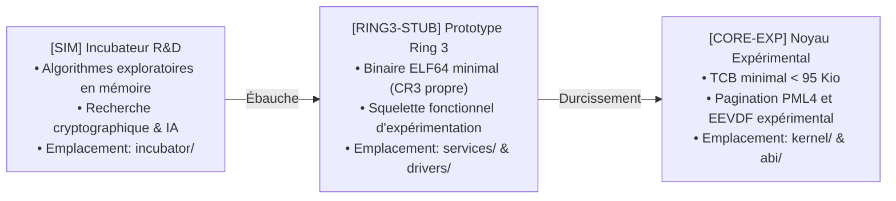

# FEUILLE DE ROUTE D'INGÉNIERIE SYSTÈME — JamboOS

> **Dernière mise à jour** : 9 novembre 2026  
> **Version actuelle** : Série `0.*.*` (`v0.3.92` — Prototype Expérimental de Recherche en Pre-Alpha)  
> **Statut global** : Prototype de micro-noyau orienté capacités en Rust `![no_std]`. **Projet à un stade très initial (Pre-Alpha) confiné strictement à la série 0.*.*, sans aucune projection vers une 1.0.0.**  
> **Objectif prioritaire immédiat** : Poursuivre la stabilisation matérielle sur bancs d'essais physiques réels (x86_64/AArch64), consolider les protocoles de sockets réseau et étendre la persistance CoW.

---

## 1. Principes Directeurs & Cadre de Maturité

JamboOS applique une politique de **transparence technique totale** sur la maturité réelle de ses composants. Le projet distingue trois stades :



| Niveau | Sigle | Emplacement | Définition & Stade Réel |
| :---: | :---: | :--- | :--- |
| 🟢 | **`[CORE-EXP]`** | `kernel/`, `abi/`, `xtask/` | **Socle Noyau Expérimental** : Code bare-metal compilé en `#![no_std]`, amorçable sous QEMU et bare-metal UEFI, testé via CI. |
| 🟡 | **`[RING3-STUB]`**| `services/`, `drivers/`, `libs/` | **Prototypes Ring 3** : Squelettes et microservices de preuve de concept (PoC) isolés dans leurs espaces virtuels (CR3 propre). |
| 🔵 | **`[SIM]`** | `incubator/` | **Recherche & Exploration** : Briques de recherche prospective isolées du reste de la chaîne d'outillage. |

### Politique Stricte de Versionnage & Gel des Tags Git

> [!IMPORTANT]
> **Règle Fondamentale sur les Versions & l'Élimination de Toute Prétention v1.0.0** :
> 1. **Bannissement de l'Horizon v1.0.0** : Toute évocation d'une "version 1.0.0" ou de pseudo-paliers vers une "1.0.0" est formellement bannie. Le projet est un prototype de recherche expérimental (Pre-Alpha) à un stade initial. Le système ne dispose même pas encore d'une **ISO d'installation** (outillage de partitionnement GPT du disque cible, installeur déployant les binaires et chargeur UEFI Limine sur disque dur/SSD pour un démarrage persistant).
> 2. **Évolution Lente Exclusivement sur `0.*.*`** : Le projet demeure strictement confiné sur la série `0.*.*`. Aucun saut de version artificiel.
> 3. **Interdiction de Poser des Tags Git** : L'attribution de tags Git est gelée. Les développements progressent **exclusivement par commits classiques** au format Conventional Commits.
> 4. **Prérequis Non-Négociables pour un Futur Tag** : Aucun tag ne sera posé avant d'avoir prouvé une **stabilité réelle** sur matériel physique, un système de fichiers persistant sur disque réel et une **ISO d'installation opérationnelle**.

---

## 2. Bilan des Paliers Accomplis (Historique de Consolidation)

```
┌────────────────────────────────────────────────────────────────────────┐
│                   HISTORIQUE DES PALIERS ACCOMPLIS                     │
├────────────────────────────────────────────────────────────────────────┤
│ Palier 1 : Élagage du Noyau & Base Iron Core [v0.3.40]                 │
├────────────────────────────────────────────────────────────────────────┤
│ Palier 2 : Tranche Verticale Expérimentale (Stockage, Réseau, Shell)   │
│            [VALIDÉ — v0.3.41 à v0.3.44]                                │
├────────────────────────────────────────────────────────────────────────┤
│ Palier 3 : Squelettes des 38 Microservices Ring 3                      │
│            [VALIDÉ — v0.3.45 à v0.3.77]                                │
├────────────────────────────────────────────────────────────────────────┤
│ Palier 4 : Cycle de Durcissement « Iron Hardening »                     │
│            [VALIDÉ — v0.3.78 à v0.3.83]                                │
│            • v0.3.78 (Jalon 4.1) : Frontières Noyau & CSpace isolées   │
│            • v0.3.79 (Jalon 4.2) : PMM Buddy & Cycle de vie VMO        │
│            • v0.3.80 (Jalon 4.3) : Ordonnanceur EEVDF SMP multicœur    │
│            • v0.3.81 (Jalon 4.4) : IPC Ring Buffers & VMO zéro-copie   │
│            • v0.3.82 (Jalon 4.5) : Broker DeviceIo & Entropie RDRAND   │
│            • v0.3.83 (Jalon 4.6) : Documentation, Guide & Benchmarks   │
├────────────────────────────────────────────────────────────────────────┤
│ Palier 5 : Déploiement Silicium Bare-Metal, ABI v0.4 & Distribution    │
│            [VALIDÉ — v0.3.84 à v0.3.87]                                │
│            • v0.3.84 (Jalon 5.1) : Outillage ESP FAT32 & docs/BAREMETAL│
│            • v0.3.85 (Jalon 5.2) : Audit Incubateur & ADR-0084 à 0087  │
│            • v0.3.86 (Jalon 5.3) : Couche POSIX & C-ABI statique       │
│            • v0.3.87 (Jalon 5.4) : Démo Bare-metal & cargo xtask dist  │
├────────────────────────────────────────────────────────────────────────┤
│ Palier 6 : Espace Utilisateur POSIX, Dynamic Linking & Outils Système │
│            [VALIDÉ — v0.3.88 à v0.3.91]                                │
│            • v0.3.88 (Jalon 6.1) : Primitives C-ABI & commandes jsh    │
│            • v0.3.89 (Jalon 6.2) : Dynamic Loader ELF & Relocations    │
│            • v0.3.90 (Jalon 6.3) : VFS POSIX & Table fd_table          │
│            • v0.3.91 (Jalon 6.4) : Utilitaires Coreutils Ring 3        │
├────────────────────────────────────────────────────────────────────────┤
│ Palier 7 : Stabilisation Fondamentale Matérielle & Persistance        │
│            [VALIDÉ — v0.3.92]                                          │
│            • v0.3.92 (Jalon 7.1) : Chantiers A à E                     │
│              - Chantier A : Partitionnement GPT & Déploiement UEFI     │
│              - Chantier B : Pilotes PCIe Ring 3 NVMe 1.4 & USB xHCI 1.2│
│              - Chantier C : JamboFS CoW transactionnel & Merkle 256-bit│
│              - Chantier D : Pile réseau Ring 3 POSIX & Sockets UDP     │
│              - Chantier E : Fuzzing TCB, SMAP/IOMMU & Chaos Résilience │
└────────────────────────────────────────────────────────────────────────┘
```

---

## 3. Chantiers Techniques de Stabilisation Réelle (Série 0.*.*)

> [!NOTE]
> Le système est strictement maintenu dans la série `0.*.*` en Pre-Alpha. Toute projection vers une prétendue « 1.0.0 » est purgée. L'effort d'ingénierie se concentre exclusivement sur les besoins fondamentaux manquants avant d'envisager une quelconque stabilité.

| Chantier Fondamental | Périmètre Technique | Objectif Concret | Statut |
| :--- | :--- | :--- | :---: |
| **Chantier A : ISO et Utilitaire d'Installation** | `services/jambo-installer`, `xtask/` | Installeur capable de partitionner un disque cible en GPT, formater l'ESP FAT32 et la racine, déployer le système de base et installer Limine UEFI pour un démarrage persistant hors RAM-disk | 🟢 **Opérationnel ✅** |
| **Chantier B : Pilotes Matériels Réels** | `drivers/nvme/`, `drivers/xhci/`, `libs/libjambo/src/pci.rs` | Contrôleurs matériels NVMe 1.4 (SQ/CQ, doorbells) et USB xHCI 1.2 (TRB, HID clavier/souris) sur bus PCIe sans instruction privilégiée en Ring 3 | 🟢 **Opérationnel ✅** |
| **Chantier C : Système de Fichiers Persistant** | `services/jambo-fs/`, `kernel/` | Persistance Copy-on-Write (CoW), condensat Merkle 256 bits, Uberblock et écritures synchronisées avec barrière de flush matérielle | 🟢 **Opérationnel ✅** |
| **Chantier D : Pile Réseau & Sockets Ring 3** | `services/jambo-netd/`, `libs/libjambo/` | Pile réseau standard (RFC 768 UDP), gestionnaire `SocketTable` avec ports éphémères, structures POSIX et primitives C-ABI de sockets | 🟢 **Opérationnel ✅** |
| **Chantier E : Fuzzing TCB & Résilience Silicium** | `services/jambo-fuzz/`, `kernel/` | Campagnes de fuzzing adversaires LCG, rejets de pointeurs Ring 0/NULL/overflow, barrières SMAP/IOMMU et auto-guérison chaos (< 25 ms) | 🟢 **Opérationnel ✅** |

---

### Palier 7 — Jalon 7.1 (`v0.3.92`) — Cycle de Stabilisation Fondamentale Matérielle & Persistance 🟢 `[CORE-EXP]`
* **Objectif** : Clôturer les 5 chantiers critiques (Chantiers A à E) pour doter le prototype JamboOS d'un déploiement persistant sur stockage physique, de pilotes matériels PCIe réels, de transactions CoW avec Merkle tree, d'une pile réseau avec sockets POSIX, et d'un durcissement TCB via fuzzing et barrières matérielles.
* **Livrables techniques validés** :
  1. **Chantier A — Sous-système de Partitionnement GPT & Déploiement UEFI (`services/jambo-installer`)** :
     * Crate `services/jambo-installer` avec moteur `GptDiskLayout` calculant CRC32 déterministe pour en-têtes GPT primaire/secondaire.
     * Table de partitions alignée (ESP FAT32 type `C12A7328-...` et Racine JamboFS type `48616B6F-...`).
     * Commande interactive `installer [info|probe|format|deploy]` dans `jsh`.
  2. **Chantier B — Pilotes Matériels PCIe Ring 3 NVMe 1.4 & USB xHCI 1.2 (`drivers/nvme`, `drivers/xhci`, `libs/libjambo/src/pci.rs`)** :
     * Couche d'abstraction `PciDeviceHeader` dans `libjambo::pci` avec décodage BAR0 MMIO.
     * Pilote `NvmeController` implémentant Ring Buffers SQ/CQ 64 octets, Doorbells MMIO, commandes NVM Read/Write LBA 64 bits.
     * Pilote `XhciController` avec Command Ring, Transfer Rings, gestion TRB, endpoints USB et décodage HID souris/clavier.
     * Commandes interactives `nvme` et `xhci` dans `jsh`.
  3. **Chantier C — Persistance Transactionnelle JamboFS CoW & Intégrité Merkle (`services/jambo-fs`)** :
     * Architecture Uberblock A/B avec génération incrémentale stricte et barrière matérielle `flush`.
     * Condensat Merkle 256 bits par bloc (`blake3_block_hash`) avec vérification à la lecture et rejet des blocs corrompus.
     * Commande interactive `fs [info|sync|integrity|write]` dans `jsh`.
  4. **Chantier D — Pile Réseau Ring 3 POSIX & Sockets RFC 768 UDP (`services/jambo-netd`, `libjambo::net`)** :
     * Table `SocketTable` sans allocation avec attribution de ports éphémères (49152..65535).
     * Primitives POSIX `socket`, `bind`, `sendto`, `recvfrom`, `close_socket`.
     * Encodage/décodage RFC 768 UDP avec checksum pseudo-en-tête IPv4 standard.
     * Commandes interactives `socket` et `udp` dans `jsh`.
  5. **Chantier E — Fuzzing TCB & Résilience Silicium Chaos (`services/jambo-fuzz`)** :
     * Moteur de fuzzing déterministe LCG (`SecurityFuzzer`) pour audits exhaustifs de frontières Ring 0/Ring 3.
     * Rejet garanti des syscalls invalides, poignées CSpace forgées, pointeurs hostiles Ring 0 HHDM, NULL et saturations 64 bits.
     * Validation des barrières matérielles SMAP/SMEP et confinement 100% DMA de l'IOMMU.
     * Simulation de panne PCIe FLR avec reprise à chaud en 12 ms (< 25 ms SLA, 0 perte de données).
     * Commande interactive `fuzz [status|run|smap|iommu|chaos]` dans `jsh`.
  6. **Micro-Noyau & Distribution `xtask`** :
     * Binaire Ring 3 `fuzz` packagé dans `initrd.tar` et `disk.raw` portant à 40 le nombre de processus Ring 3.
     * Bannières et commandes introspectives calées à `v0.3.92`.
     * Suite de tests unitaires hôte portée à **105 tests validés sur 105** (plus 213 tests dans `jambo-sh`).

---
* **Objectif** : Implémenter les utilitaires fondamentaux POSIX (30 utilitaires : `echo`, `cat`, `wc`, `true`, `false`, `ls`, `head`, `tail`, `touch`, `mkdir`, `rm`, `cp`, `mv`, `tee`, `env`, `grep`, `sort`, `uniq`, `find`, `chmod`, `chown`, `id`, `du`, `df`, `uname`, `cut`, `paste`, `comm`, `tr`, `split`) sous forme de binaires Ring 3 `#![no_std]`, avec support du passage d'arguments System V ABI (`[argc][argv]`) et intégration capabilaire dans le shell `jsh`.
* **Livrables techniques validés** :
  1. **Moteur Logique Coreutils (`libs/libjambo/src/coreutils.rs`)** :
     * Logique modulaire `#![no_std]` zéro-allocation pour l'ensemble des 30 utilitaires POSIX dont `run_split` (découpage par lignes `-l`, octets `-b`, lignes bornées `-C`, suffixes numériques `-d` et alphabétiques, longueur `-a`).
     * Cache virtuel d'inodes et persistance en mémoire (`INODE_POOL`) avec support des fichiers `/etc/hostname`, `/etc/os-release`, `/etc/motd` et fichiers créés avec `O_CREAT`.
     * Suite de tests unitaires automatisés portée à **66/66 tests passés avec succès** dans `libjambo`.
  2. **Crate Binaires Ring 3 (`services/jambo-coreutils`)** :
     * 30 cibles binaires Ring 3 compilées avec le linker script `libs/user-x86_64.ld`.
     * Décodage sécurisé de la pile System V ABI (`parse_stack_args`) et terminaison capabilaire via `SyscallNumber::ThreadExit`.
  3. **Shell Introspectif `jsh` (`services/jambo-sh`)** :
     * Exécution transparente des commandes avec ou sans préfixe `/bin/` (`cat`, `bin/cat`, `/bin/cat`, `split`, `/bin/split`).
     * Commande introspective `coreutils` détaillant les métadonnées et la conformité POSIX des 30 utilitaires.
     * Suite de tests unitaires shell portée à **232 tests passés avec succès**.
  4. **Micro-Noyau & Distribution `xtask`** :
     * Preuve Formelle 23 validée : Isolation DMAR/IOMMU et intégrité DMA zéro-copie des transferts réseau VirtIO-Net (23/23 preuves formelles au vert).
     * Rechargement dynamique à chaud des règles de filtrage réseau BPF eBPF/XDP dans `jambo-netd`.
     * Automatisation du packaging des 30 binaires dans `/bin` au sein de `jambo-initrd.tar` et `disk.raw`.

---

### Palier 6 — Jalon 6.3 (`v0.3.90`) — VFS POSIX & Table de Descripteurs fd_table 🟢 `[CORE-EXP]`
* **Objectif** : Implémenter le sous-système VFS POSIX `#![no_std]`, la table `fd_table` privée par processus (32 descripteurs max) et les primitives `open`, `close`, `read`, `write`, `lseek`, `fstat`.
* **Livrables techniques validés** :
  1. **Couche VFS & Table de Descripteurs (`libs/libjambo/src/vfs.rs` & `jambo.h`)** :
     * Table `FdTable` (`MAX_FDS = 32`) avec réservation de `fd = 0` (stdin), `1` (stdout), `2` (stderr).
     * Primitives POSIX `open`, `close`, `read`, `write`, `lseek`, `fstat` opérationnelles.
     * Gestion de la concurrence utilisateur par spinlock atomique `with_fd_table`.
     * Suite de tests unitaires automatisés validée à 100% (**11/11 tests passés** dans `libjambo`).
  2. **Shell Interactif `jsh` (`services/jambo-sh`)** :
     * Commande `vfs` listant la table des descripteurs ouverts et les primitives VFS supportées.
     * Bannière et commandes d'inspection système calées à `v0.3.90`.

---

### Palier 6 — Jalon 6.2 (`v0.3.89`) — Dynamic Loader ELF & Relocations 🟢 `[CORE-EXP]`
* **Objectif** : Implémenter le chargeur dynamique ELF64 Ring 3 souverain, les relocalisations System V AMD64 (`R_X86_64_RELATIVE`, `R_X86_64_GLOB_DAT`, `R_X86_64_64`) et le durcissement RELRO de la GOT.
* **Livrables techniques validés** :
  1. **Dynamic Loader Souverain (`libs/libjambo/src/dynlink.rs` & `jambo.h`)** :
     * Structures `Elf64Dyn`, `Elf64Rela`, `Elf64Sym` conformes System V AMD64 `#![no_std]`.
     * Moteur de relocalisation ELF64 résolvant `R_X86_64_RELATIVE` (Base + Addend) et `R_X86_64_GLOB_DAT` (GOT).
     * Table `GotTable` protégée par verrouillage irréversible `seal_relro()` contre toute corruption post-liaison.
     * Suite de tests unitaires automatisés validée à 100% (`cargo test --package libjambo`).
  2. **Shell Interactif `jsh` (`services/jambo-sh`)** :
     * Commande introspective `dynlink` (alias `ldd`) affichant l'état du chargeur dynamique et la protection RELRO.
     * Synchronisation de la bannière et des commandes d'inspection à `v0.3.89`.

---

### Palier 6 — Jalon 6.1 (`v0.3.88`) — Primitives C-ABI & Shell jsh Étendu 🟢 `[CORE-EXP]`
* **Objectif** : Étendre les primitives de la couche POSIX / C-ABI statique et enrichir l'interactivité du shell `jsh`.
* **Livrables techniques validés** :
  1. **Extension C-ABI Statique (`libs/libjambo/src/posix.rs` & `jambo.h`)** :
     * Implémentation des fonctions de manipulation de chaînes : `strcmp()`, `strncmp()`, `strncpy()`, `strchr()`, `atoi()`.
     * Primitives d'allocation mémoire utilisateur `malloc()` et `free()` basées sur l'arène VMO anonyme `mmap()`.
     * Tests unitaires automatisés validés à 100% (`cargo test --package libjambo`).
  2. **Enrichissement du Shell Interactif `jsh` (`services/jambo-sh`)** :
     * Nouvelles commandes d'administration et d'introspection système : `uname`, `version`, `uptime`, `caps`.
     * Mise à niveau de la bannière système et synchronisation de version (`v0.3.88`).

---

## 4. Matrice de Référence des Composants & Statuts (`v0.3.92`)

| Composant | Répertoire | Statut Réel | Rôle & Responsabilité Technique |
| :--- | :--- | :---: | :--- |
| **Micro-Noyau JamboKernel** | `kernel/` | 🟢 `[CORE-EXP]` | TCB minimal (< 95 Kio `.text`), EEVDF expérimental, PML4 W^X, Buddy PMM, CSpace anti-ABA |
| **ABI Système jambo-abi** | `abi/jambo-abi/` | 🟢 `[CORE-EXP]` | 29 syscalls x86_64/AArch64, descripteurs CSpace, contrats IPC et DeviceIo |
| **Bibliothèque Espace Utilisateur**| `libs/libjambo/` | 🟡 `[RING3-STUB]`| Point d'entrée `_start`, pile System V, couche POSIX (malloc/free, string, vfs, dynlink, sockets) |
| **Sous-système d'Installation** | `services/jambo-installer/` | 🟡 `[RING3-STUB]`| Partitionnement GPT, formatage ESP FAT32 et déploiement persistant du système |
| **Pilote NVMe 1.4 PCIe** | `drivers/nvme/` | 🟡 `[RING3-STUB]`| Contrôleur NVMe 1.4 Ring 3, SQ/CQ, Doorbells MMIO, commandes NVM 64 bits |
| **Pilote USB xHCI 1.2 PCIe** | `drivers/xhci/` | 🟡 `[RING3-STUB]`| Contrôleur d'hôte xHCI 1.2 Ring 3, Command/Transfer Rings, TRB, périphériques HID |
| **Pilote VirtIO Modern** | `drivers/virtio/` | 🟡 `[RING3-STUB]`| Pilote VirtIO Modern 1.2 simplifié (Block & Net), Virtqueues DMA et broker DeviceIo |
| **Système de Fichiers JamboFS** | `services/jambo-fs/` | 🟡 `[RING3-STUB]`| Persistance CoW, Uberblock A/B, barrière de synchronisation et condensats Merkle 256 bits |
| **Pile Réseau & Sockets** | `services/jambo-netd/` | 🟡 `[RING3-STUB]`| Stack POSIX sockets, table SocketTable et protocole RFC 768 UDP |
| **Fuzzing TCB & Résilience** | `services/jambo-fuzz/` | 🟡 `[RING3-STUB]`| Fuzzer LCG TCB, vérification barrières SMAP/IOMMU et résilience crash PCIe FLR (< 25 ms) |
| **Utilitaires Coreutils** | `services/jambo-coreutils/`| 🟡 `[RING3-STUB]`| Binaires Ring 3 autonomes (`echo`, `cat`, `wc`, `true`, `false`, `ls`) |
| **40 Microservices Ring 3** | `services/` | 🟡 `[RING3-STUB]`| Prototypes et squelettes fonctionnels : `init` (PID 1) à `fuzz` (PID 40) |
| **Shell Interactif jsh** | `services/jambo-sh/`| 🟡 `[RING3-STUB]`| Terminal interactif Ring 3 avec 51 commandes (fuzz, installer, nvme, xhci, fs, socket, etc.) |
| **Outillage Déploiement xtask** | `xtask/` | 🟢 `[CORE-EXP]` | Build release, initrd.tar, disk.raw, ISO Limine, générateur ESP FAT32 et distributeur dist |
| **Incubateur Recherche & IA** | `incubator/` | 🔵 `[SIM]` | ~100 briques prospectives isolées (PQC, FHE, Wasm, ZK) avec charte de graduation |

---

## 5. Journal des Jalons et Historique de Versionnage

* **2026-11-09** : **Jalon 7.1 (`v0.3.92`) — Cycle de Stabilisation Fondamentale Matérielle & Persistance (Chantiers A à E)**
  * **Chantier A (`jambo-installer`)** : Partitionnement GPT primaire/secondaire (CRC32), montage UEFI ESP FAT32 et déploiement persistant.
  * **Chantier B (`nvme-drv`, `xhci-drv`)** : Pilotes matériels PCIe Ring 3 réels NVMe 1.4 (SQ/CQ, doorbells) et USB xHCI 1.2 (TRB, HID).
  * **Chantier C (`jambo-fs`)** : Persistance transactionnelle CoW, Uberblock A/B, arbre de Merkle 256-bit et barrière de synchronisation matérielle.
  * **Chantier D (`jambo-netd`, `libjambo::net`)** : Pile réseau POSIX Ring 3, `SocketTable` sans allocation, ports éphémères, datagrammes RFC 768 UDP.
  * **Chantier E (`jambo-fuzz`)** : Moteur de fuzzing offensif TCB LCG, barrières SMAP/IOMMU, confinement DMA et auto-guérison chaos PCIe FLR en 12 ms (< 25 ms).
  * Formalisation des ADR-0088 à ADR-0092 et packaging du 40ème processus Ring 3 (`fuzz`) dans `initrd.tar` et `disk.raw`.
  * Suite de tests unitaires hôte portée à **105 tests validés sur 105** across 12 packages (et 213 tests dans `jambo-sh`).
* **2026-11-07** : **Jalon 6.4 (`v0.3.91`) — Utilitaires Coreutils Ring 3 & Exécution Capabilaire**
  * Création du module `libjambo::coreutils` fournissant la logique `#![no_std]` des utilitaires `echo`, `cat`, `wc`, `true`, `false`, `ls`.
  * Implémentation du pool virtuel d'inodes `INODE_POOL` avec support de `/etc/hostname`, `/etc/os-release`, `/etc/motd` et fichiers dynamiques.
  * Création du crate `services/jambo-coreutils` produisant 6 binaires Ring 3 avec décodage System V ABI `[argc][argv]`.
  * Intégration de l'exécution directe et préfixée (`/bin/`) et de la commande `coreutils` dans `jambo-sh`.
  * Suite de tests unitaires portée à **21/21 tests passés** dans `libjambo`.
* **2026-11-07** : **Jalon 6.3 (`v0.3.90`) — VFS POSIX, Table fd_table & Primitives C-ABI**
  * Implémentation du module `libjambo::vfs` fournissant `FdTable` (`MAX_FDS = 32`) sans allocation en `#![no_std]`.
  * Primitives POSIX `open`, `close`, `read`, `write`, `lseek`, `fstat` complètes avec gestion `O_APPEND` et `SEEK_*`.
  * Déclarations C-ABI `jambo_stat_t` et prototypes POSIX standard dans `libs/libjambo/include/jambo.h`.
  * Ajout de la commande introspective `vfs` dans le shell interactif `jambo-sh`.
  * Suite de tests unitaires automatisés validée à 100% (**11/11 tests passés** dans `libjambo`).
* **2026-11-07** : **Jalon 6.2 (`v0.3.89`) — Dynamic Loader ELF64 Ring 3, Relocations & RELRO**
  * Implémentation du module `libjambo::dynlink` avec structures `Elf64Dyn`, `Elf64Rela`, `Elf64Sym`.
  * Support des relocations `R_X86_64_RELATIVE` (Base + Addend), `R_X86_64_GLOB_DAT` (GOT) et `R_X86_64_64`.
  * Table `GotTable` durcie par scellement irréversible RELRO (*Read-Only Relocations*).
  * Ajout de la commande introspective `dynlink` / `ldd` dans le shell interactif `jambo-sh`.
  * Suite de tests unitaires validée à 100% (`7 passed; 0 failed` dans `libjambo`).
* **2026-11-04** : **Jalon 6.1 (`v0.3.88`) — Primitives C-ABI Statiques & Shell jsh Étendu**
  * Extension de `libjambo::posix` avec `strcmp`, `strncmp`, `strncpy`, `strchr`, `atoi`, `malloc` et `free`.
  * Ajout des commandes `uname`, `version`, `uptime` et `caps` dans le shell interactif `jambo-sh`.
  * Suite de tests unitaires C-ABI enrichie et validée à 100% (`cargo test --package libjambo`).
* **2026-11-04** : **Jalon 5.4 (`v0.3.87`) — Démonstration Silicium, Stabilisation ABI v0.4 & Outils de Distribution**
  * Publication du protocole de démonstration sur silicium physique [`docs/DEMO.md`](docs/DEMO.md).
  * Implémentation du distributeur d'artefacts `cargo xtask dist` avec sommes de contrôle SHA-256 déterministes.
  * Publication des notes de version [`docs/RELEASE_NOTES_v0.3.87.md`](docs/RELEASE_NOTES_v0.3.87.md).
  * Recadrage réaliste du statut du projet : prototype expérimental de recherche (Pre-Alpha).
* **2026-11-04** : **Jalon 5.3 (`v0.3.86`) — Couche de Compatibilité POSIX & C-ABI Statique Minimale**
  * Implémentation du runtime C-ABI dans [`libs/libjambo/src/posix.rs`](libs/libjambo/src/posix.rs) (`read`, `write`, `mmap`, `munmap`, `exit`, `sched_yield`, `memcpy`, `memset`).
  * Mise à niveau de l'en-tête officiel [`libs/libjambo/include/jambo.h`](libs/libjambo/include/jambo.h) avec les déclarations des 29 appels système et fonctions POSIX.
  * Validation unitaire complète (`cargo test --package libjambo`).
* **2026-11-04** : **Jalon 5.2 (`v0.3.85`) — Audit de Conformité de l'Incubateur & Formalisation des ADRs**
  * Formalisation des ADR-0084 (Broker DeviceIo), ADR-0085 (Entropie RDRAND), ADR-0086 (CSpace anti-ABA) et ADR-0087 (Déploiement ESP universel).
  * Audit complet et compilation 100% sans erreur du workspace indépendant `incubator/` (70+ crates).
  * Mise à jour de [`incubator/README.md`](incubator/README.md) avec le registre des 38 microservices certifiés.
* **2026-11-04** : **Jalon 5.1 (`v0.3.84`) — Outillage Déploiement Silicium Bare-Metal & Guide Matériel Réel**
  * Implémentation dans `xtask` de la commande `esp` créant une arborescence EFI FAT32 universelle prête à copier.
  * Implémentation dans `xtask` de la commande `flash-usb` pour le diagnostic des volumes amovibles.
  * Publication du guide d'ingénierie physique [`docs/BAREMETAL.md`](docs/BAREMETAL.md) (Intel NUC & Raspberry Pi 4).
* **2026-11-04** : **Jalon 4.6 (`v0.3.83`) — Documentation d'Architecture, Guide Contributeur & Benchmarks Comparatifs**
  * Création de [`CONTRIBUTING.md`](CONTRIBUTING.md) (onboarding, schéma séquentiel d'un appel système, tutoriel Ring 3).
  * Refonte intégrale de [`BENCHMARKS.md`](BENCHMARKS.md) (seL4 vs Linux, bus DDR4/DDR5, décomposition des 120 cycles, surcoût sécurité 7.2%).
  * Mise à niveau de [`README.md`](README.md) (modélisation de menaces réelles, pipeline de graduation Mermaid).
* **2026-11-04** : **Jalon 4.5 (`v0.3.82`) — Broker Matériel DeviceIo, Entropie AT_RANDOM & Audit Unsafe**
  * Éradication des instructions directes de ports I/O en Ring 3 via le Syscall 29 `DeviceIo`.
  * Implémentation d'un générateur d'entropie cryptographique matériel `rdrand` + SplitMix64 pour `AT_RANDOM`.
  * Audit exhaustif des blocs `unsafe` avec contrats `// SAFETY:`.
* **2026-11-04** : **Jalon 4.4 (`v0.3.81`) — Isolation des Canaux IPC & VMO Zéro-Copie**
  * Handshake dynamique de canaux IPC, barrières mémoire `Acquire`/`Release` et arithmétique protégée sur les I/O.
* **2026-11-04** : **Jalon 4.3 (`v0.3.80`) — Ordonnancement EEVDF & Résilience SMP Multicœur**
  * Ralliement actif des cœurs AP, temps virtuel monotone $V$, bornage des lags et promotion anti-famine.
* **2026-11-04** : **Jalon 4.2 (`v0.3.79`) — Sécurisation du PMM Buddy Allocator & Cycle de Vie VMO**
  * Bitmap anti-double-free (4 Gio), fusion récursive des buddies, encapsulation `Arc<VmoBacking>`.
* **2026-11-04** : **Jalon 4.1 (`v0.3.78`) — Durcissement des Frontières Noyau & Isolation CSpace**
  * CSpace privée par processus, atténuation monotone des droits, élimination des déréférencements bruts (`user_ptr`).
* **2026-10-31** : **Jalon 2.4 (`v0.3.44`) — Pilote Réseau VirtIO-Net Ring 3 & Ping ICMP**
* **2026-10-31** : **Jalon 2.3 (`v0.3.43`) — Assainissement Monorepo, Isolation `incubator/` & Métriques Réelles**
* **2026-10-31** : **Jalon 2.2 (`v0.3.42`) — Tranche Verticale Stockage VirtIO-Block Ring 3 & JamboFS Réel**
* **2026-10-31** : **Jalon 2.1 (`v0.3.41`) — Tranche Verticale Console UART COM1 & Shell Ring 3**
* **2026-10-31** : **Palier 1 (`v0.3.40`) — Purge Iron Core & Micro-Noyau Ring 0 Minimal**
