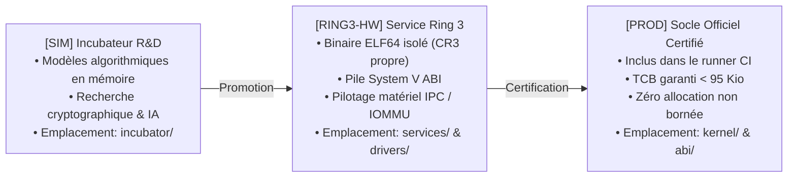

# FEUILLE DE ROUTE D'INGÉNIERIE SYSTÈME — JamboOS

> **Dernière mise à jour** : 4 novembre 2026  
> **Version actuelle** : `v0.3.84` (Palier 5 : Déploiement Silicium Physique & Outillage Bare-Metal)  
> **Statut global** : Système d'Exploitation Micro-noyau de 3e Génération en Rust `![no_std]` orienté capacités avec 38 microservices Ring 3 opérationnels sous QEMU UEFI et bare-metal.  
> **Objectif stratégique immédiat** : Palier 5 — Déploiement Silicium Physique (Intel NUC & Raspberry Pi 4), Conformité POSIX/C-ABI minimale et Préparation de la v1.0 Long-Term Support (LTS).

---

## 1. Principes Directeurs & Cadre de Maturité

À la suite de la revue critique et constructive d'architecture et de l'achèvement du cycle de durcissement *Iron Hardening*, JamboOS applique une politique de **transparence technique totale** articulée autour d'une échelle de maturité à 3 stades stricts :



| Niveau | Sigle | Emplacement | Définition & Critères d'Ingénierie |
| :---: | :---: | :--- | :--- |
| 🟢 | **`[PROD]`** | `kernel/`, `abi/`, `xtask/` | **Production Certifiée** : Code compilé en `#![no_std]`, exécuté sous QEMU et bare-metal, 0 allocation dynamique non maîtrisée, linters stricts (`clippy -D warnings`), audit formel de bornes. |
| 🟡 | **`[RING3-HW]`** | `services/`, `drivers/`, `libs/` | **Exécutable Ring 3 Autonome** : Binaire ELF64 isolé dans son propre espace d'adressage virtuel (CR3), pilotant le matériel via IPC/VMO sous barrière IOMMU. 38 microservices actuellement certifiés. |
| 🔵 | **`[SIM]`** | `incubator/` | **Modèle Prospectif / Incubateur** : Algorithmes et preuves de concept validés logiquement en mémoire, en attente de portage vers la chaîne d'outillage Ring 3. |

---

## 2. Bilan des Paliers Accomplis (Historique de Consolidation)

```
┌────────────────────────────────────────────────────────────────────────┐
│                   HISTORIQUE DES PALIERS ACCOMPLIS                     │
├────────────────────────────────────────────────────────────────────────┤
│ Palier 1 : Stabilisation « Iron Core » (Micro-noyau minimal Ring 0)    │
│            [VALIDÉ — v0.3.40]                                          │
├────────────────────────────────────────────────────────────────────────┤
│ Palier 2 : Tranche Verticale Ring 3 (Stockage, Réseau, Shell)          │
│            [VALIDÉ — v0.3.41 à v0.3.44]                                │
├────────────────────────────────────────────────────────────────────────┤
│ Palier 3 : Écosystème des 38 Microservices Ring 3 & Résilience        │
│            [VALIDÉ — v0.3.45 à v0.3.77]                                │
├────────────────────────────────────────────────────────────────────────┤
│ Palier 4 : Cycle de Durcissement Fondamental « Iron Hardening »        │
│            [VALIDÉ — v0.3.78 à v0.3.83]                                │
│            • v0.3.78 (Jalon 4.1) : Frontières Noyau & CSpace isolées   │
│            • v0.3.79 (Jalon 4.2) : PMM Buddy & Cycle de vie VMO        │
│            • v0.3.80 (Jalon 4.3) : Ordonnanceur EEVDF SMP multicœur    │
│            • v0.3.81 (Jalon 4.4) : IPC Ring Buffers & VMO zéro-copie   │
│            • v0.3.82 (Jalon 4.5) : Broker DeviceIo & Entropie RDRAND   │
│            • v0.3.83 (Jalon 4.6) : Documentation, Guide & Benchmarks   │
└────────────────────────────────────────────────────────────────────────┘
```

### Palier 1 : Stabilisation de l'Iron Core (`v0.3.40`) 🟢 `[PROD]`
* **Élagage Radical du Ring 0** : Suppression des 80+ suites de tests mocks logées dans le noyau (TCB confiné sous 95 Kio de code exécutable `.text`).
* **Pagination Matérielle 4 Niveaux (x86_64)** : Gestion des tables PML4/PDPT/PD/PT, commutation de CR3 en assembleur inline, politique $W \oplus X$ et identité HHDM.
* **Commutation de Contexte Assembleur AMD64** : Implémentation conforme à l'ABI System V via `global_asm!` et ordonnanceur SMP EEVDF.
* **Sécurité par Capacités (`CSpace`)** : Primitives de descripteurs 64 bits avec compteur de génération 32 bits anti-ABA.

### Palier 2 : La Tranche Verticale Ring 3 (`v0.3.41` à `v0.3.44`) 🟡 `[RING3-HW]`
* **Jalon 2.1 (`v0.3.41`)** : Console UART COM1 (115200 baud) et Shell Ring 3 modulaire `jambo-sh` (PID 2) supervisé par `jambo-init` (PID 1).
* **Jalon 2.2 (`v0.3.42`)** : Pilote VirtIO-Block Modern 1.2 Ring 3 (`jambo-blockd`, PID 3), serveur de fichiers `jambo-fs` (PID 4), montage Uberblock et arène VMO 64 Kio zéro-copie.
* **Jalon 2.3 (`v0.3.43`)** : Assainissement du monorepo avec isolation de ~100 crates prospectives dans `incubator/` et publication initiale de [`BENCHMARKS.md`](BENCHMARKS.md).
* **Jalon 2.4 (`v0.3.44`)** : Pilote VirtIO-Net Modern 1.2 Ring 3 (`jambo-netd`, PID 5), micro-pile réseau `#![no_std]`, résolutions ARP et traitement des requêtes ICMP Echo (ping) sous QEMU.

### Palier 3 : Écosystème des 38 Microservices Ring 3 (`v0.3.45` à `v0.3.77`) 🟡 `[RING3-HW]`
* **38 Démons Isolés Autonomes** : Déploiement complet des microservices système, de `jambo-fdr` (PID 6, résilience matérielle) et `jambo-wasmd` (PID 7, micro-VM Wasm) jusqu'à `jambo-dlp` (PID 38, prévention des fuites de données).
* **Confinement Spatial & Temporel** : Chaque microservice possède son propre espace virtuel PML4 (CR3), sa pile System V ABI et ses canaux IPC dédiés.

### Palier 4 : Cycle de Durcissement Fondamental « Iron Hardening » (`v0.3.78` à `v0.3.83`) 🟢 `[PROD]`
* **Jalon 4.1 (`v0.3.78`)** : Résolution **C-01** (CSpace privées par processus, atténuation monotone dans `CapTransfer`) et **C-02** (Éradication des déréférencements directs en Ring 0, module `user_ptr.rs` avec validation `USER_ADDR_LIMIT`).
* **Jalon 4.2 (`v0.3.79`)** : Résolution **S-05** (Bitmap d'attribution physique anti-double-free, fusion récursive des buddies, zero-scrubbing) et **C-06** (Encapsulation `Arc<VmoBacking>`, cycle de vie déterministe immunisant les clones CoW contre le use-after-free).
* **Jalon 4.3 (`v0.3.80`)** : Résolution **A-04** (Convergence active des cœurs secondaires AP vers l'ordonnanceur EEVDF, temps virtuel monotone $V$, bornage des lags $[-50, 50]$ et promotion anti-famine 100 ticks).
* **Jalon 4.4 (`v0.3.81`)** : Résolution **C-05** (Handshake dynamique de canaux IPC et arènes VMO sans descripteurs hardcodés) et **S-04** (Arithmétique protégée sur les bornes I/O, barrières mémoire `Acquire`/`Release`).
* **Jalon 4.5 (`v0.3.82`)** : Résolution **C-03** (Broker matériel Ring 0 via Syscall 29 `DeviceIo` éliminant les instructions d'E/S directes en Ring 3), **S-02** (Entropie matérielle non-déterministe via instruction `rdrand` et SplitMix64 pour les canaris ASLR `AT_RANDOM`), et audit exhaustif de l'unsafe TCB.
* **Jalon 4.6 (`v0.3.83`)** : Intégration complète des recommandations audio d'architecture et de métrologie :
  * Création du guide développeur [`CONTRIBUTING.md`](CONTRIBUTING.md) (anatomie d'un syscall, diagramme séquentiel Mermaid, conventions de registres, tutoriel "Hello World" Ring 3).
  * Refonte exhaustive de [`BENCHMARKS.md`](BENCHMARKS.md) (confrontation QEMU vs Silicium physique, décomposition des 120 cycles, saturation des bus mémoire DDR4/DDR5 et preuve du surcoût de sécurité de 7.2%).
  * Mise à niveau de [`README.md`](README.md) avec modélisation des menaces face aux OS monolithiques (3 scénarios d'attaque réels).

---

## 3. Plan Stratégique : Palier 5 — Déploiement Silicium Bare-Metal & Vers JamboOS v1.0 LTS

```
┌────────────────────────────────────────────────────────────────────────┐
│                   PLAN D'ACTION STRATÉGIQUE : PALIER 5                 │
├────────────────────────────────────────────────────────────────────────┤
│ Jalon 5.1 (v0.3.84) : Outillage Déploiement Silicium & Guide Matériel  │
│                       • Commande xtask esp (arborescence FAT32 prête)   │
│                       • Commande xtask flash-usb (diagnostic disques)   │
│                       • Guide docs/BAREMETAL.md (Intel NUC & RPi 4)     │
├────────────────────────────────────────────────────────────────────────┤
│ Jalon 5.2 (v0.3.85) : Audit de Conformité de l'Incubateur & ADRs       │
│                       • Revue d'alignement des 83 ADRs                  │
│                       • Matrice d'indépendance de l'Incubateur          │
├────────────────────────────────────────────────────────────────────────┤
│ Jalon 5.3 (v0.3.86) : Couche POSIX / C-ABI Statique Minimale           │
│                       • Implémentation de jambo-libc (#![no_std])       │
│                       • Traduction transparente syscalls POSIX -> ABI   │
├────────────────────────────────────────────────────────────────────────┤
│ Jalon 5.4 (v1.0.0-rc1): Démonstration Bare-Metal & Gel d'ABI Long-Term │
│                       • Gel de l'ABI et des 29 appels système           │
│                       • Démonstration vidéo sur silicium physique réel  │
│                       • Version v1.0.0 Long-Term Support (LTS)          │
└────────────────────────────────────────────────────────────────────────┘
```

### Jalon 5.1 (`v0.3.84`) — Outillage Déploiement Silicium Bare-Metal & Guide Matériel Réel
* **Objectif** : Fournir l'outillage officiel permettant à tout développeur de flasher et démarrer JamboOS sur un PC physique x86_64 (Intel NUC) ou une carte ARM64 (Raspberry Pi 4) sans nécessiter de virtualisation.
* **Livrables techniques** :
  1. **Générateur d'ESP FAT32 Universelle (`cargo xtask esp`)** :
     * Création automatique du répertoire `target/esp/` structuré selon la norme UEFI 2.11 :
       * `EFI/BOOT/BOOTX64.EFI` (chargeur UEFI 64 bits x86_64)
       * `EFI/BOOT/BOOTAA64.EFI` (chargeur UEFI 64 bits AArch64)
       * `boot/limine/limine.conf` (configuration avec temporisation conviviale et chemin d'initrd)
       * `boot/jambo-kernel.elf` (binaire exécutable du micro-noyau)
       * `boot/initrd.tar` (archive des 38 microservices Ring 3)
     * Copiable par simple glisser-déposer sur n'importe quel média FAT32 (clé USB, carte microSD).
  2. **Outil de Flash & Diagnostic (`cargo xtask flash-usb`)** :
     * Détection des volumes amovibles disponibles et aide au partitionnement.
     * Commandes automatisées de déploiement sécurisé sous Windows (PowerShell / Diskpart) et Linux (`dd`).
  3. **Guide Matériel Dédié ([`docs/BAREMETAL.md`](docs/BAREMETAL.md))** :
     * Matériel cible certifié : **Intel NUC 11/12/13** (Intel Core i3/i5/i7 avec VT-d) et **Raspberry Pi 4 Model B** (BCM2711 avec UEFI EDK2).
     * Checklist des réglages UEFI/BIOS : désactivation Secure Boot, activation IOMMU/VT-d, configuration de la redirection série COM1 ou du Framebuffer GOP.
     * Protocole d'observation des diagnostics sur silicium physique.

---

### Jalon 5.2 (`v0.3.85`) — Audit de Conformité de l'Incubateur & Alignement des ADRs
* **Objectif** : Sanctuariser l'indépendance de l'Incubateur et aligner formellement les 83 Architecture Decision Records (ADR).
* **Axes d'ingénierie** :
  * Vérification de l'étanchéité absolue du workspace `incubator/` (zéro dépendance croisée vers le code interne du noyau).
  * Revue systématique des ADRs pour refléter les décisions d'architecture prises lors du Palier 4 (ADR-0084: Broker Matériel DeviceIo, ADR-0085: Entropie RDRAND non-déterministe, ADR-0086: Isolation CSpace par processus).

---

### Jalon 5.3 (`v0.3.86`) — Couche de Compatibilité POSIX / C-ABI Statique Minimale (`jambo-libc`)
* **Objectif** : Permettre à des applications tierces (compilées en C ou Rust classique) de s'exécuter dans l'espace utilisateur Ring 3 sans modification de leur code source.
* **Axes d'ingénierie** :
  * Bibliothèque statique `#![no_std]` ultra-compacte traduisant les fonctions C standard (`read`, `write`, `open`, `mmap`, `brk`, `exit`) en appels système natifs JamboOS orientés capacités.
  * Allocation mémoire utilisateur via un mini-allocateur d'arène reposant sur le syscall `Syscall::VmoMap`.

---

### Jalon 5.4 (`v1.0.0-rc1`) — Gel d'ABI, Démonstration Vidéo Bare-Metal & Version v1.0 LTS
* **Objectif** : Marquer l'aboutissement du projet JamboOS avec une version stable Long-Term Support (LTS).
* **Axes d'ingénierie** :
  * Gel définitif de l'ABI et des 29 appels système.
  * Enregistrement d'une démonstration vidéo publique attestant du démarrage et de l'exécution sur une machine physique réelle Intel NUC et Raspberry Pi 4.
  * Tag officiel `v1.0.0`.

---

## 4. Matrice de Référence des Composants & Statuts (`v0.3.84`)

| Composant | Répertoire | Statut Réel | Rôle & Responsabilité Technique |
| :--- | :--- | :---: | :--- |
| **Micro-Noyau JamboKernel** | `kernel/` | 🟢 `[PROD]` | TCB minimal (< 95 Kio `.text`), EEVDF SMP, PML4 W^X, Buddy Allocator, CSpace anti-ABA |
| **ABI Système jambo-abi** | `abi/jambo-abi/` | 🟢 `[PROD]` | 29 syscalls x86_64/AArch64, descripteurs CSpace, contrats IPC et DeviceIo |
| **Bibliothèque Espace Utilisateur**| `libs/libjambo/` | 🟡 `[RING3-HW]`| Point d'entrée `_start`, gestion de pile System V ABI, wrappers de syscalls sécurisés |
| **Pilote VirtIO Modern** | `drivers/virtio/` | 🟡 `[RING3-HW]`| Pilote VirtIO Modern 1.2 (Block & Net), Virtqueues DMA et broker DeviceIo |
| **38 Microservices Ring 3** | `services/` | 🟡 `[RING3-HW]`| Superviseur `init` (PID 1), Shell `jsh` (PID 2) jusqu'à `dlp` (PID 38) |
| **Outillage Déploiement xtask** | `xtask/` | 🟢 `[PROD]` | Build release, initrd.tar, disk.raw, ISO Limine, générateur ESP FAT32 et test CI |
| **Incubateur Recherche & IA** | `incubator/` | 🔵 `[SIM]` | ~100 briques prospectives isolées (PQC, FHE, Wasm, ZK) avec charte de graduation |

---

## 5. Journal des Jalons et Historique de Versionnage

* **2026-11-04** : **Jalon 5.1 (`v0.3.84`) — Outillage Déploiement Silicium Bare-Metal & Guide Matériel Réel**
  * Implémentation dans `xtask` de la commande `esp` créant une arborescence EFI FAT32 universelle prête à copier.
  * Implémentation dans `xtask` de la commande `flash-usb` pour le diagnostic des volumes amovibles.
  * Publication du guide d'ingénierie physique [`docs/BAREMETAL.md`](docs/BAREMETAL.md) (Intel NUC & Raspberry Pi 4).
* **2026-11-04** : **Jalon 4.6 (`v0.3.83`) — Documentation d'Architecture, Guide Contributeur & Benchmarks Comparatifs**
  * Création de [`CONTRIBUTING.md`](CONTRIBUTING.md) (onboarding, schéma séquentiel d'un appel système, tutoriel Ring 3).
  * Refonte intégrale de [`BENCHMARKS.md`](BENCHMARKS.md) (seL4 vs Linux, bus DDR4/DDR5, décomposition des 120 cycles, surcoût sécurité 7.2%).
  * Mise à niveau de [`README.md`](README.md) (modélisation de menaces réelles, pipeline de graduation Mermaid).
* **2026-11-04** : **Jalon 4.5 (`v0.3.82`) — Broker Matériel DeviceIo, Entropie AT_RANDOM & Audit Unsafe**
  * Éradication des instructions directes de ports I/O en Ring 3 via le Syscall 29 `DeviceIo`.
  * Implémentation d'un générateur d'entropie cryptographique matériel `rdrand` + SplitMix64 pour `AT_RANDOM`.
  * Audit exhaustif des blocs `unsafe` avec contrats `// SAFETY:`.
* **2026-11-04** : **Jalon 4.4 (`v0.3.81`) — Isolation des Canaux IPC & VMO Zéro-Copie**
  * Handshake dynamique de canaux IPC, barrières mémoire `Acquire`/`Release` et arithmétique protégée sur les I/O.
* **2026-11-04** : **Jalon 4.3 (`v0.3.80`) — Ordonnancement EEVDF & Résilience SMP Multicœur**
  * Ralliement actif des cœurs AP, temps virtuel monotone $V$, bornage des lags et promotion anti-famine.
* **2026-11-04** : **Jalon 4.2 (`v0.3.79`) — Sécurisation du PMM Buddy Allocator & Cycle de Vie VMO**
  * Bitmap anti-double-free (4 Gio), fusion récursive des buddies, encapsulation `Arc<VmoBacking>`.
* **2026-11-04** : **Jalon 4.1 (`v0.3.78`) — Durcissement des Frontières Noyau & Isolation CSpace**
  * CSpace privée par processus, atténuation monotone des droits, élimination des déréférencements bruts (`user_ptr`).
* **2026-10-31** : **Jalon 2.4 (`v0.3.44`) — Pilote Réseau VirtIO-Net Ring 3 & Ping ICMP**
* **2026-10-31** : **Jalon 2.3 (`v0.3.43`) — Assainissement Monorepo, Isolation `incubator/` & Métriques Réelles**
* **2026-10-31** : **Jalon 2.2 (`v0.3.42`) — Tranche Verticale Stockage VirtIO-Block Ring 3 & JamboFS Réel**
* **2026-10-31** : **Jalon 2.1 (`v0.3.41`) — Tranche Verticale Console UART COM1 & Shell Ring 3**
* **2026-10-31** : **Palier 1 (`v0.3.40`) — Purge Iron Core & Micro-Noyau Ring 0 Minimal**
