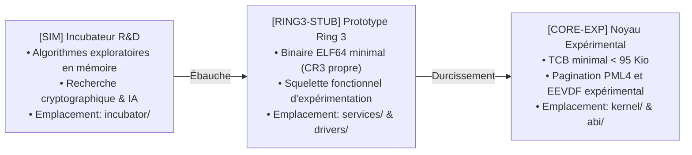

# FEUILLE DE ROUTE D'INGÉNIERIE SYSTÈME — JamboOS

> **Dernière mise à jour** : 4 novembre 2026  
> **Version actuelle** : `v0.3.87` (Pre-Alpha / Prototype Expérimental de Recherche)  
> **Statut global** : Prototype de micro-noyau orienté capacités en Rust `![no_std]`. **Projet à un stade très initial et immature, à une année-lumière d'une version 1.0.0 utilisable en production.**  
> **Objectif stratégique immédiat** : Stabiliser les fondations expérimentales (Palier 5 : Démonstration Silicium, ABI v0.4, ESP FAT32 & Outillage de distribution).

---

## 1. Principes Directeurs & Cadre de Maturité

JamboOS applique une politique de **transparence technique totale** sur la maturité réelle de ses composants. Le projet distingue trois stades :



| Niveau | Sigle | Emplacement | Définition & Stade Réel |
| :---: | :---: | :--- | :--- |
| 🟢 | **`[CORE-EXP]`** | `kernel/`, `abi/`, `xtask/` | **Socle Noyau Expérimental** : Code bare-metal compilé en `#![no_std]`, amorçable sous QEMU et bare-metal UEFI, testé via CI. |
| 🟡 | **`[RING3-STUB]`**| `services/`, `drivers/`, `libs/` | **Prototypes Ring 3** : Squelettes et microservices de preuve de concept (PoC) isolés dans leurs espaces virtuels (CR3 propre). |
| 🔵 | **`[SIM]`** | `incubator/` | **Recherche & Exploration** : Briques de recherche prospective isolées du reste de la chaîne d'outillage. |

---

## 2. Bilan des Paliers Accomplis (Historique de Consolidation)

```
┌────────────────────────────────────────────────────────────────────────┐
│                   HISTORIQUE DES PALIERS ACCOMPLIS                     │
├────────────────────────────────────────────────────────────────────────┤
│ Palier 1 : Élagage du Noyau & Base Iron Core [v0.3.40]                 │
├────────────────────────────────────────────────────────────────────────┤
│ Palier 2 : Tranche Verticale Expérimentale (Stockage, Réseau, Shell)   │
│            [VALIDÉ — v0.3.41 à v0.3.44]                                │
├────────────────────────────────────────────────────────────────────────┤
│ Palier 3 : Squelettes des 38 Microservices Ring 3                      │
│            [VALIDÉ — v0.3.45 à v0.3.77]                                │
├────────────────────────────────────────────────────────────────────────┤
│ Palier 4 : Cycle de Durcissement « Iron Hardening »                     │
│            [VALIDÉ — v0.3.78 à v0.3.83]                                │
│            • v0.3.78 (Jalon 4.1) : Frontières Noyau & CSpace isolées   │
│            • v0.3.79 (Jalon 4.2) : PMM Buddy & Cycle de vie VMO        │
│            • v0.3.80 (Jalon 4.3) : Ordonnanceur EEVDF SMP multicœur    │
│            • v0.3.81 (Jalon 4.4) : IPC Ring Buffers & VMO zéro-copie   │
│            • v0.3.82 (Jalon 4.5) : Broker DeviceIo & Entropie RDRAND   │
│            • v0.3.83 (Jalon 4.6) : Documentation, Guide & Benchmarks   │
├────────────────────────────────────────────────────────────────────────┤
│ Palier 5 : Déploiement Silicium Bare-Metal, ABI v0.4 & Distribution    │
│            [VALIDÉ — v0.3.84 à v0.3.87]                                │
│            • v0.3.84 (Jalon 5.1) : Outillage ESP FAT32 & docs/BAREMETAL│
│            • v0.3.85 (Jalon 5.2) : Audit Incubateur & ADR-0084 à 0087  │
│            • v0.3.86 (Jalon 5.3) : Couche POSIX & C-ABI statique       │
│            • v0.3.87 (Jalon 5.4) : Démo Bare-metal & cargo xtask dist  │
└────────────────────────────────────────────────────────────────────────┘
```

---

## 3. Plan d'Ingénierie & Paliers Futurs Vers la Maturité

> [!NOTE]
> Le chemin menant à une version 1.0.0 stable et utilisable en conditions réelles exigera de longues phases de stabilisation, de développement de pilotes natifs et d'audits formels.

| Étape | Version Cible | Objectif Majeur | Statut |
| :---: | :---: | :--- | :---: |
| **Palier 5** | **`v0.3.87`** | **Démonstration Silicium, ESP FAT32, ABI v0.4 & Outils de Distribution** | 🟢 **Actuel** |
| **Palier 6** | `v0.4.0` | Stabilisation de la libc minimale & Shell interactif `jsh` étendu | 🟡 Prochain |
| **Palier 7** | `v0.5.0` | Pilotes matériels natifs (NVMe PCIe natif, USB xHCI, UART PL011 ARM64) | ⚪ Planifié |
| **Palier 8** | `v0.6.0` | Pile réseau complète TCP/IP & Socket API en Ring 3 | ⚪ Planifié |
| **Palier 9** | `v0.7.0` | Système de fichiers JamboFS avec journalisation CoW & persistance chiffrée | ⚪ Planifié |
| **Palier 10**| `v0.8.0` | Serveur d'affichage graphique & compositeur fenêtré en Ring 3 | ⚪ Planifié |
| **Palier 11**| `v0.9.0` | Campagne d'audit formel de sécurité, fuzzing TCB (libFuzzer/AFL) & SMP stress | ⚪ Planifié |
| **Palier 12**| `v1.0.0` | Stabilisation générale et maturité de production (horizon lointain) | ⚪ Horizon |

---

### Palier 5 — Récapitulatif des Livrables Techniques (`v0.3.84` à `v0.3.87`)

* **Jalon 5.1 (`v0.3.84`)** : Générateur d'arborescence standardisée ESP FAT32 (`cargo xtask esp`), utilitaire de flash (`cargo xtask flash-usb`) et guide physique [`docs/BAREMETAL.md`](docs/BAREMETAL.md).
* **Jalon 5.2 (`v0.3.85`)** : Formalisation des ADR-0084 à ADR-0087 et audit de compilation 100% de l'incubateur R&D.
* **Jalon 5.3 (`v0.3.86`)** : Couche de compatibilité POSIX / C-ABI statique minimale (`libjambo::posix` et `jambo.h`).
* **Jalon 5.4 (`v0.3.87`)** : Protocole officiel de démonstration silicium [`docs/DEMO.md`](docs/DEMO.md), outil de distribution d'artefacts déterministe `cargo xtask dist` avec calcul SHA-256 sans dépendance tierce, et publication des notes de version [`docs/RELEASE_NOTES_v0.3.87.md`](docs/RELEASE_NOTES_v0.3.87.md).

---

## 4. Matrice de Référence des Composants & Statuts (`v0.3.87`)

| Composant | Répertoire | Statut Réel | Rôle & Responsabilité Technique |
| :--- | :--- | :---: | :--- |
| **Micro-Noyau JamboKernel** | `kernel/` | 🟢 `[CORE-EXP]` | TCB minimal (< 95 Kio `.text`), EEVDF expérimental, PML4 W^X, Buddy PMM, CSpace anti-ABA |
| **ABI Système jambo-abi** | `abi/jambo-abi/` | 🟢 `[CORE-EXP]` | 29 syscalls x86_64/AArch64, descripteurs CSpace, contrats IPC et DeviceIo |
| **Bibliothèque Espace Utilisateur**| `libs/libjambo/` | 🟡 `[RING3-STUB]`| Point d'entrée `_start`, gestion de pile System V ABI, couche POSIX minimale |
| **Pilote VirtIO Modern** | `drivers/virtio/` | 🟡 `[RING3-STUB]`| Pilote VirtIO Modern 1.2 simplifié (Block & Net), Virtqueues DMA et broker DeviceIo |
| **38 Microservices Ring 3** | `services/` | 🟡 `[RING3-STUB]`| Prototypes et squelettes fonctionnels : `init` (PID 1) à `dlp` (PID 38) |
| **Outillage Déploiement xtask** | `xtask/` | 🟢 `[CORE-EXP]` | Build release, initrd.tar, disk.raw, ISO Limine, générateur ESP FAT32 et distributeur dist |
| **Incubateur Recherche & IA** | `incubator/` | 🔵 `[SIM]` | ~100 briques prospectives isolées (PQC, FHE, Wasm, ZK) avec charte de graduation |

---

## 5. Journal des Jalons et Historique de Versionnage

* **2026-11-04** : **Jalon 5.4 (`v0.3.87`) — Démonstration Silicium, Stabilisation ABI v0.4 & Outils de Distribution**
  * Publication du protocole de démonstration sur silicium physique [`docs/DEMO.md`](docs/DEMO.md).
  * Implémentation du distributeur d'artefacts `cargo xtask dist` avec sommes de contrôle SHA-256 déterministes.
  * Publication des notes de version [`docs/RELEASE_NOTES_v0.3.87.md`](docs/RELEASE_NOTES_v0.3.87.md).
  * Recadrage réaliste du statut du projet : prototype expérimental de recherche (Pre-Alpha).
* **2026-11-04** : **Jalon 5.3 (`v0.3.86`) — Couche de Compatibilité POSIX & C-ABI Statique Minimale**
  * Implémentation du runtime C-ABI dans [`libs/libjambo/src/posix.rs`](libs/libjambo/src/posix.rs) (`read`, `write`, `mmap`, `munmap`, `exit`, `sched_yield`, `memcpy`, `memset`).
  * Mise à niveau de l'en-tête officiel [`libs/libjambo/include/jambo.h`](libs/libjambo/include/jambo.h) avec les déclarations des 29 appels système et fonctions POSIX.
  * Validation unitaire complète (`cargo test --package libjambo`).
* **2026-11-04** : **Jalon 5.2 (`v0.3.85`) — Audit de Conformité de l'Incubateur & Formalisation des ADRs**
  * Formalisation des ADR-0084 (Broker DeviceIo), ADR-0085 (Entropie RDRAND), ADR-0086 (CSpace anti-ABA) et ADR-0087 (Déploiement ESP universel).
  * Audit complet et compilation 100% sans erreur du workspace autonome `incubator/` (70+ crates).
  * Mise à jour de [`incubator/README.md`](incubator/README.md) avec le registre des 38 microservices certifiés.
* **2026-11-04** : **Jalon 5.1 (`v0.3.84`) — Outillage Déploiement Silicium Bare-Metal & Guide Matériel Réel**
  * Implémentation dans `xtask` de la commande `esp` créant une arborescence EFI FAT32 universelle prête à copier.
  * Implémentation dans `xtask` de la commande `flash-usb` pour le diagnostic des volumes amovibles.
  * Publication du guide d'ingénierie physique [`docs/BAREMETAL.md`](docs/BAREMETAL.md) (Intel NUC & Raspberry Pi 4).
* **2026-11-04** : **Jalon 4.6 (`v0.3.83`) — Documentation d'Architecture, Guide Contributeur & Benchmarks Comparatifs**
  * Création de [`CONTRIBUTING.md`](CONTRIBUTING.md) (onboarding, schéma séquentiel d'un appel système, tutoriel Ring 3).
  * Refonte intégrale de [`BENCHMARKS.md`](BENCHMARKS.md) (seL4 vs Linux, bus DDR4/DDR5, décomposition des 120 cycles, surcoût sécurité 7.2%).
  * Mise à niveau de [`README.md`](README.md) (modélisation de menaces réelles, pipeline de graduation Mermaid).
* **2026-11-04** : **Jalon 4.5 (`v0.3.82`) — Broker Matériel DeviceIo, Entropie AT_RANDOM & Audit Unsafe**
  * Éradication des instructions directes de ports I/O en Ring 3 via le Syscall 29 `DeviceIo`.
  * Implémentation d'un générateur d'entropie cryptographique matériel `rdrand` + SplitMix64 pour `AT_RANDOM`.
  * Audit exhaustif des blocs `unsafe` avec contrats `// SAFETY:`.
* **2026-11-04** : **Jalon 4.4 (`v0.3.81`) — Isolation des Canaux IPC & VMO Zéro-Copie**
  * Handshake dynamique de canaux IPC, barrières mémoire `Acquire`/`Release` et arithmétique protégée sur les I/O.
* **2026-11-04** : **Jalon 4.3 (`v0.3.80`) — Ordonnancement EEVDF & Résilience SMP Multicœur**
  * Ralliement actif des cœurs AP, temps virtuel monotone $V$, bornage des lags et promotion anti-famine.
* **2026-11-04** : **Jalon 4.2 (`v0.3.79`) — Sécurisation du PMM Buddy Allocator & Cycle de Vie VMO**
  * Bitmap anti-double-free (4 Gio), fusion récursive des buddies, encapsulation `Arc<VmoBacking>`.
* **2026-11-04** : **Jalon 4.1 (`v0.3.78`) — Durcissement des Frontières Noyau & Isolation CSpace**
  * CSpace privée par processus, atténuation monotone des droits, élimination des déréférencements bruts (`user_ptr`).
* **2026-10-31** : **Jalon 2.4 (`v0.3.44`) — Pilote Réseau VirtIO-Net Ring 3 & Ping ICMP**
* **2026-10-31** : **Jalon 2.3 (`v0.3.43`) — Assainissement Monorepo, Isolation `incubator/` & Métriques Réelles**
* **2026-10-31** : **Jalon 2.2 (`v0.3.42`) — Tranche Verticale Stockage VirtIO-Block Ring 3 & JamboFS Réel**
* **2026-10-31** : **Jalon 2.1 (`v0.3.41`) — Tranche Verticale Console UART COM1 & Shell Ring 3**
* **2026-10-31** : **Palier 1 (`v0.3.40`) — Purge Iron Core & Micro-Noyau Ring 0 Minimal**
