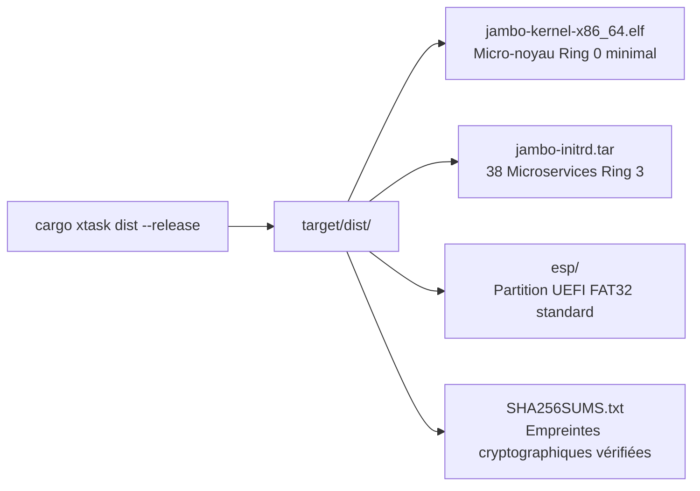

# Notes de Version — JamboOS v0.3.87 (Phase Alpha / Prototype Silicium)

> **Projet** : JamboOS (`jambostack/jambo-os`)  
> **Date de Publication** : 4 novembre 2026  
> **Version** : `v0.3.87` (Palier 5 : Démonstration Silicium, Stabilisation ABI v0.4 & Outil de Distribution)  
> **Statut** : Phase Alpha de Recherche & Développement / Prototype Avancé  
> **Auteur & Architecte Principal** : ASSOGBA Prudence Dieudonné  
> **Dépôt Officiel** : [https://github.com/jambostack/jambo-os](https://github.com/jambostack/jambo-os)

---

## 1. Vue d'Ensemble & Positionnement de la Release

La version **v0.3.87** de **JamboOS** franchit une étape charnière du cycle de développement : elle concrétise la capacité du micro-noyau à démarrer et opérer sur du matériel physique réel (*bare-metal* sur Intel NUC x86_64 et Raspberry Pi 4 ARM64), tout en stabilisant le contrat d'appel système de l'espace utilisateur (ABI v0.4 à 29 appels système) et en fournissant un outillage complet de distribution d'images.

> [!NOTE]
> **Clarification sur la Maturité** : JamboOS est un projet de micro-noyau en phase de développement actif (**Alpha**). La version `1.0.0` (production générale) constitue un horizon lointain qui requiert encore des audits de sécurité formels, le développement de pilotes matériels natifs supplémentaires (NVMe, USB xHCI natif), et des campagnes exhaustives de fuzzing et de tests sur parc hétérogène.

---

## 2. Nouveautés & Livrables Techniques du Jalon 5.4 (`v0.3.87`)

### 1. Protocole Officiel de Démonstration Silicium ([`docs/DEMO.md`](docs/DEMO.md))
* Protocole pas-à-pas en 6 étapes pour reproduire les démonstrations sur machine physique sans outil propriétaire.
* Validation de l'amorçage UEFI Limine (GOP 1080p), de l'initialisation du TCB Ring 0 (< 95 Kio `.text`), du ralliement multicœur SMP AP vers l'ordonnanceur EEVDF, et du lancement supervisé des 38 microservices Ring 3.
* Scénarios de preuve : zéro autorité ambiante, barrière IOMMU sur les pilotes et redémarrage à chaud sans panique noyau.

### 2. Distributeur d'Artefacts Déterministe (`cargo xtask dist`)
* Ajout de la sous-commande `dist` dans `xtask` orchestrant la génération complète des livrables système.
* Calcul déterministe des empreintes cryptographiques SHA-256 en Rust pur (FIPS 180-4) sans dépendance tierce.
* Production automatique de l'arborescence `target/dist/` avec `SHA256SUMS.txt`.

### 3. Stabilisation de l'ABI v0.4 & Couche POSIX Statique
* Figeage des 29 appels système pour les exécutables Ring 3 dans `jambo-abi`.
* Couche d'émulation POSIX et C-ABI statique dans `libjambo::posix` (`write`, `read`, `mmap`, `sched_yield`, `exit`, `memcpy`, `memset`).

---

## 3. Feuille de Route Réaliste Vers la Version 1.0.0

L'accession à une version 1.0.0 de production industrielle suivra des paliers progressifs et rigoureux :

| Étape | Version Cible | Objectif Majeur | Statut |
| :---: | :---: | :--- | :---: |
| **Palier 5** | **`v0.3.87`** | **Démonstration Silicium, ESP FAT32, ABI v0.4 & Outils de Distribution** | 🟢 **Actuel** |
| **Palier 6** | `v0.4.0` | Stabilisation de l'API standard C/Rust Ring 3 & Shell jsh interactif étendu | 🟡 Prochain |
| **Palier 7** | `v0.5.0` | Pilotes matériels natifs (NVMe PCIe natif, USB xHCI, UART PL011 ARM64) | ⚪ Planifié |
| **Palier 8** | `v0.6.0` | Pile réseau complète TCP/IP & Socket API en Ring 3 | ⚪ Planifié |
| **Palier 9** | `v0.7.0` | Système de fichiers JamboFS avec journalisation CoW & persistance chiffrée | ⚪ Planifié |
| **Palier 10**| `v0.8.0` | Serveur d'affichage graphique & compositeur fenêtré en Ring 3 | ⚪ Planifié |
| **Palier 11**| `v0.9.0` | Campagne d'audit formel de sécurité, fuzzing TCB (libFuzzer/AFL) & SMP stress | ⚪ Planifié |
| **Palier 12**| `v1.0.0` | Version Long-Term Support (LTS) certifiée pour la production critique | ⚪ Horizon |

